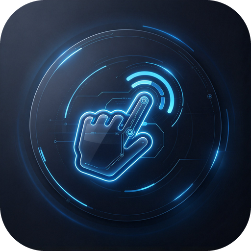

<p align="center">
  
</p>

# HandSolo · 单手

**为一只手校准的鼠标。** 用摄像头控制 Windows 光标：MediaPipe 手部关键点 →
手势状态机 → `user32.SendInput` 注入。只伸一根食指移动光标，拇指捏一下点击，
食指+中指上下划滚动，左右挥动翻页。**不需要任何额外硬件，一个摄像头就够了。**

- 平台：Windows 10 / 11（非 Windows 自动降级为 `--safe-mode`，只跑状态机不注入）
- Python：>= 3.10（推荐 3.12）
- 版本：**0.11.0**
- 许可：MIT（引擎层移植自 [`KIdiens/Vimoose`](https://github.com/KIdiens/Vimoose)，见 [`LICENSE`](LICENSE)）

---

## 这是什么

一个**单手**、**免接触**的鼠标替代品。适用场景：躺着用电脑、手上有水/油、手部
活动受限、或者单纯不想摸鼠标。

它和「摄像头手势识别 demo」的区别在于**它是个能天天用的输入设备**：

- 30fps 端到端，光标跟手；抖动用 One Euro 滤波 + 瞄准死区压住；
- 点击是**捏合**（拇指靠近食指），不是"悬停多久"这种猜意图的方式；
- 捏住不放会升级成拖拽，捏两下是双击，语义和鼠标一致；
- 有**急停**（`Ctrl+Alt+Esc`）：立刻松开左键并暂停，不会出现"左键卡住"；
- 可选**控件磁吸**：靠近按钮边缘自动吸附中心，小目标也好点。

## 为什么叫 HandSolo

`solo` 有两层意思，正好是这个项目的两个前提：**只用一只手**、**只为一个人校准**。
系统里所有阈值（捏合触发比、磁吸窗口、双击间隔）都是按**单个使用者的真实姿态**
标定的，而不是按"平均人"；模型也会在"这不像他的手"时**拒识**而不是硬猜。

代价是：**换一个人，捏合阈值几乎一定需要重新调**。这是刻意的取舍 ——
通用阈值在所有人身上都是"勉强能用"，专用阈值在一个人身上才是"真的好用"。
怎么调见 [`docs/tuning.md`](docs/tuning.md)。

---

## 安装：两种方式，选一个

| 方式 | 适合谁 | 要装什么 | 怎么开始 |
|---|---|---|---|
| **A. 免安装 exe** | 不想碰命令行 | **什么都不用装** | 下载 `HandSolo.exe`，双击 |
| **B. 从源码跑** | 想改代码 / 自己调参 | Python 3.10+ | 见下面「快速开始」 |

两个版本在 [Releases](https://github.com/captian-cr/HandSolo/releases) 里都有，功能完全一样。

### A. 免安装 exe（推荐给不想装 Python 的人）

1. 到 Releases 下载 `HandSolo.exe`（约 **117MB**，因为 MediaPipe + OpenCV 都打进去了）；
2. **放到一个你打算长期使用的目录**（别放在下载文件夹，它会在同目录生成 `config.json` 和 `logs/`）；
3. 双击运行。

要知道的几件事：

- **首次启动慢 2~4 秒**：单文件 exe 要先把内容解压到临时目录（之后每次启动都这样，不是坏了）；
- **没有黑窗口**：出错会弹系统对话框，详细原因写在 exe 同目录的 `logs\handmouse-<日期>.log`；
- **Windows 会拦一次，这是正常的**：双击后可能弹「Windows 已保护你的电脑」→
  点**更多信息 → 仍要运行**。原因是这个 exe 没有代码签名证书（个人项目不做商业签名），
  不是文件坏了。杀软（尤其 360/火绒）也可能报，需要手动加白名单；
- **首次使用同样要录你自己的手**：双击后它会提示，命令行加 `--onboarding` 也行：
  ```
  HandSolo.exe --onboarding
  ```

## 快速开始（Windows）

### 1. 装 Python

到 [python.org](https://www.python.org/downloads/) 装 3.12，安装时**勾上
`Add python.exe to PATH`**。装完在 PowerShell 里验证：

```bat
python --version
```

### 2. 拿到代码

```powershell
git clone <本仓库地址> D:\HandSolo
cd "D:\HandSolo"
```

> 🔴 **`cd /d` 是 cmd 的写法，PowerShell 里会报"找不到接受实际参数的位置形式参数"。**
> Windows 11 默认终端是 PowerShell，用 `cd "D:\HandSolo"`；
> 老式 cmd 才是 `cd /d D:\HandSolo`。混用会报错，而且后面那条命令会在**旧目录**里跑，
> 表现为 `No module named handmouse`。

没有 git 也能用：仓库页面右上角 **Code → Download ZIP**，解压到任意目录。

### 3. 装依赖

```bat
python -m pip install -e ".[core]"
```

`core` 就够了（摄像头 + 关键点 + 光标注入）。想要控件磁吸再加 `".[uia]"`
（会让小图标好点很多，建议装）：

```bat
python -m pip install -e ".[uia]"
```

> 手部模型 `handmouse/models/hand_landmarker.task` 随仓库分发，**运行时不联网下载**。

### 4. 体检一下摄像头

```bat
python scripts\probe_camera.py
```

看到 `实际画面：640×480（宽高比 1.333，4:3）`、`实测帧率：30 fps` 就说明硬件没问题。
不是 4:3 也不用改配置 —— 程序会自动补偿（原理见 [`docs/hardware.md`](docs/hardware.md)）。

### 5. ⚠️ 先录一遍你自己的手（约 2 分钟）

**这一步不要跳。** 所有阈值都是按**一个人的手**标定的，作者的手不等于你的手。
跳过它会变成"能识别但不好用"——那不是 bug，是拿别人的尺子量你。

```bat
python -m handmouse --onboarding
```

（或双击 **`HandSolo（首次设置）.bat`**，需要先跑过一次第 7 步的生成脚本。）

向导会做三件事，全程不动鼠标：

1. **标定 3 个点**（屏幕中央 / 左上 / 右下）：十字**只表示屏幕上的方位，
   不是让你把手放上去**——手放在你自己最舒服的位置，捏合一下，
   程序就把你捏合的位置记成"对应屏幕上那个点"。三个点圈出你的活动范围；
2. **量速率**：像平时那样动一动手，它记录**你自己的习惯速度**；
3. **过手势**：七种手势，每种**先给你看题目、你捏合确认后**才开始录
   （准备 2 秒 + 练习 5 秒），边做边显示识别结果，同时录成你自己的样本库。

**只需做一次。** 做完会写 `onboarding_done = true`，之后启动不再提；你没做的话也只会提醒一次（不会每次开都催你）。
换了摄像头、或手在桌上的位置变了，只需要重新对一遍活动范围：
`python -m handmouse --recalibrate`（**不碰你的手势样本**）。

细节与常见问题见 [`docs/first-run.md`](docs/first-run.md)。

### 6. 跑起来

```bat
python -m handmouse
```

会弹出一个预览窗。**默认是暂停的**，对镜头**五指张开保持约 0.8 秒**（或按 `M`）
即接管光标。

### 7. （可选）做成双击启动，以后不碰终端

```bat
python scripts\make_launchers.py
```

会在仓库根目录生成三份 `.bat`，并把两份快捷方式放到桌面 / 启动文件夹：

| 启动器 | 行为 |
|---|---|
| **`启动 HandSolo.bat`** | 主入口。`pythonw.exe` 启动，**没有黑窗口**，只有预览窗 |
| `HandSolo（后台无预览）.bat` | 不带预览窗，最省 CPU（实测 30fps / CPU 0.7%） |
| `HandSolo（诊断·看报错）.bat` | 保留控制台，崩了能直接看到 traceback |
| `HandSolo（首次设置）.bat` | 首次设置向导（标点 + 量速率 + 过手势），必须带控制台 |

### 预览窗：随时能关，也随时能打开

预览窗会抢焦点、也占 CPU，所以三种控制方式都给了。**不用重启程序**：

| 想做什么 | 怎么做 |
|---|---|
| 一开始就不要 | 启动加 `--no-preview`，或双击 **`HandSolo（后台无预览）.bat`** |
| 运行中**关掉** | 窗口里按 **`P`**，或全局按 **`Ctrl+Alt+P`** |
| 关掉后**再打开** | 只能按 **`Ctrl+Alt+P`**（窗口没了，窗口内的键就跟着失效了） |

关掉之后没有任何窗口，但**状态仍然看得到**：光标旁边那个小圆环会用颜色告诉你
当前是控制中 / 捏合 / 拖拽 / 未进入控制态（对照表见下面「状态圆环的颜色」）。
关掉预览实测 **30fps、CPU 0.7%**，比开着省一半以上。

> 反过来说：**开着预览时 `M` / `R` / `ESC` 才有效**（键盘事件要靠窗口收）。
> 关掉之后只剩全局热键 `Ctrl+Alt+G` / `Ctrl+Alt+P` / `Ctrl+Alt+Esc` / `Ctrl+Alt+Q`。

`pythonw.exe` 没有控制台，所以输出会写到 `logs\handmouse-<日期>.log`；启动失败会
弹系统对话框，不会"双击之后什么都没发生"。**用桌面 / 启动文件夹那两份前，
先确认它们写的是你项目所在的绝对路径**（生成脚本会写死当时的路径，搬家后要重新生成）。

---

## 硬件要求

| 项目 | 最低 | 推荐 |
|---|---|---|
| 摄像头 | 320×240 @ 15fps | **640×480 @ 30fps**（任何 USB 摄像头都行） |
| 接口 | USB 2.0 | USB 3.0 |
| CPU | 4 核 | 6 核以上 |
| 显卡 | 不需要 | MediaPipe 走 CPU |

**720p / 1080p 不会让识别更准** —— MediaPipe 会把手部图解算到固定输入尺寸，
源分辨率再高，送进模型的还是同一份东西；反而更吃 CPU 和 USB 带宽。
升分辨率的唯一收益是左右视野更宽。完整说明见 [`docs/hardware.md`](docs/hardware.md)。

> 换摄像头**不需要重新标定捏合阈值**：程序会把画面宽高比随每帧传给手势引擎，
> 把横向长度还原到 4:3 标定尺度（4:3 时倍率恰为 1.000，历史阈值零变化；
> 16:9 时倍率 1.333，把 25% 的缩水补回来）。实测 4:3→16:9 不补偿时捏合比
> 会漂 **+19% ~ +32%**，补偿后为 **+0.0%**。

---

## 手势一览

| 手势 | 效果 | 备注 |
|---|---|---|
| **五指张开**（保持约 0.8 秒） | 接管 / 唤醒 | 从暂停态恢复控制；开机自启后就是这么启动 |
| **只伸食指** | 移动光标 | 允许其余手指自然半弯，不必僵着 |
| **捏合**（拇指尖靠近食指尖） | 单击 | 捏住再松开才提交，防止路过误点 |
| **捏合两下**（窗口内、落点相近） | 双击 | 第一次捏合不会提前单击 |
| **捏合后保持** | 拖拽 | `drag_hold_ms` 到期即按住左键 |
| **食指 + 中指上下划** | 滚动 | 两指要伸出来，其余握起 |
| **食指 + 中指左右划** | 上一页 / 下一页 | 同上；可单独关掉导航 |
| **五指张开 + 左右挥动** | 上一页 / 下一页 | 待机态的副产品 |
| **光标停住约 1 秒** | 打开磁吸窗口 | 不发任何指令，只是把小目标吸过来 |
| **握拳保持** | 冻结 / 退出控制态 | 应急用；`fist_exits_gate=false` 时只冻结不退出 |

**已被移除的手势**（历史版本有，现版本没有，别照着旧文档找）：

- ❌ **张开手掌上下移动滚动** —— 判据在侧手角度下不可分，已删除，现在上下平移**无任何输出**；
- ❌ **翻腕滚动** —— 同上，已删除。

`rotation_gestures_enabled` 残留的语义只是"翻腕时别把光标误判成握拳"，不产生滚动。

---

## 状态圆环的颜色

预览窗关掉（`--no-preview` 或按 `P`）时，状态全靠**跟着光标走的那个小圆环**。
颜色就是当前状态，对照表如下：

| 颜色 | 状态 | 含义 |
|---|---|---|
| 🟢 绿 `#22c55e` | `pointer` / `partial_index` | **控制中**，光标可动 |
| 🟠 橙 `#f59e0b` | `pinch_armed` / `left_pinch` / `right_pinch` | **捏合中**（正在点击/准备拖拽） |
| 🔵 蓝 `#3b82f6` | `drag` | **拖拽中**（左键按住） |
| 🟣 紫 `#a855f7` | `swipe` / `page_next` / `page_previous` | **滑动**（滚动或翻页） |
| ⚪ 灰 `#9ca3af` | `open_palm` / `fist` | **待机 / 握拳**（不移动光标） |
| 🔴 红 `#ef4444` | `gate_idle` | **未进入控制态**（要做五指张开进入姿势） |
| ⚫ 深灰 `#6b7280` | `paused` / `lost` | **已暂停 / 丢手**（手不在画面里） |

记忆方法：**能动的都是绿→蓝，要按键的都是橙，不给动的都是灰，出问题就是红**。

## 应用底部的悬浮球：怎么拉大小

每个前台应用窗口底部会有一颗**白色圆球**。它就是"拖拽式拉伸窗口"的手柄：
**用光标捏住它（捏合 = 按住左键），往某个方向拖，松手回弹**。

| 往哪个方向拉 | 效果 |
|---|---|
| **向左拉** | 左边缘向左扩，右边缘不动 |
| **向右拉** | 右边缘向右扩，左边缘不动 |
| **向下拉** | 整体等比放大 |
| **向上拉** | 整体等比缩小 |
| 斜着拉 | 水平与垂直同时生效（一边扩边一边缩放） |

几个细节：

- **只作用于当前前台窗口**，不动背景窗口；
- 松手后形变会**弹簧式回弹**到新尺寸，不是硬切；
- 球**静止 2 秒会淡出**，动一下鼠标/手就回来（不挡视线）；
- **抓住球那一下的捏合不会点到下面的东西**——否则一拉就把应用点开了；
- 不想要它：`config.json` 里 `window_ball_enabled` 改成 `false`。

## 按键与热键

### 控制类

| 按键 | 作用 |
|---|---|
| `M` | 暂停 / 恢复（接管） |
| `R` | 重置光标滤波器 |
| `P` | 开 / 关预览窗（等于 `Ctrl+Alt+P`，但需要窗口有焦点） |
| `ESC` / `Q` | 退出 |
| `Ctrl+Alt+G` | 接管（**窗口失焦也生效**） |
| `Ctrl+Alt+Esc` | **急停**：立刻松开左键并暂停控制 |
| `Ctrl+Alt+P` | **开 / 关预览窗**（关掉之后窗口就没了，只有这个全局键能叫回来） |
| `Ctrl+Alt+Q` | 退出 |

### 实时调参（预览窗获得焦点时才生效）

调完会立刻打印当前数值，可以一边做手势一边微调：

| 按键 | 作用 | 改的是 |
|---|---|---|
| `,` / `.` | 手停住时更稳 / 更跟手 | `pointer_stability` ±0.04 |
| `<` / `>` | 大幅快速移动时更稳 / 更贴手 | `pointer_response` ±0.04 |
| `[` / `]` | 手行程更精细 / 更灵敏 | 四边内缩 ±0.02 |
| `+` / `-` | 摇杆速度 ×1.2 / ÷1.2 | `cursor_speed_multiplier`（仅摇杆模式有用） |

🔴 **这些改动只在本次运行的内存里生效，退出就没了**（程序只在**启动时**写
`config.json`，从不回写）。调到满意的数值后，自己把那个键写进 `config.json`。

### 两个关于按键的实际限制

- **无预览窗模式下 `M` / `R` / `ESC` / `Q` 全部失效**（没有窗口接键盘），
  只剩全局热键 `Ctrl+Alt+G` / `Ctrl+Alt+Esc` / `Ctrl+Alt+Q`。
- `R` / `ESC` 在部分输入法状态下会被吞。**急停请一律用 `Ctrl+Alt+Esc`**，
  它走 `GetAsyncKeyState` 轮询，不依赖窗口焦点。

全局热键走 `GetAsyncKeyState` 每 30ms 轮询（不用 `RegisterHotKey`：会被 QQ / 输入法
抢占，且消息会被 `waitKey` 的 `PeekMessage` 取走）。

## 命令行

```bat
python -m handmouse                          :: 启动，默认不接管，按 M 或五指张开才接管
python -m handmouse --safe-mode              :: 不注入任何系统输入，只跑状态机 + 预览窗
python -m handmouse --no-preview             :: 不要预览窗，最省 CPU
python -m handmouse --auto-control           :: 启动即接管
python -m handmouse --camera 1               :: 用 1 号摄像头
python -m handmouse --diagnostic-seconds 20  :: 跑 20 秒后打印指标并退出
```

| 参数 | 说明 |
|---|---|
| `--config PATH` | 配置文件路径，默认仓库根 / EXE 同级 `config.json` |
| `--camera N` | 摄像头序号，覆盖 config |
| `--safe-mode` | 不注入任何系统输入 |
| `--auto-control` | 启动即接管（默认先暂停） |
| `--no-snap` | 关闭控件磁吸 |
| `--no-preview` | 不显示预览窗（轻量后台） |
| `--multi-monitor` / `--virtual-desk` | 多屏坐标映射 / 单屏实验开关 |
| `--margin X Y` | 活动区左右 / 上下内缩比例 |
| `--diagnostic-seconds S` | 跑 S 秒后打印指标并退出 |
| `--sample-seconds S` | 采样心跳间隔，默认 10 |
| `--guided` | 引导式基线：按固定节拍提示 6 步操作并自动出诊断 |
| `--gate-diag` | 进入门定点排查（需 `HANDMOUSE_VERBOSE_GATE=1`） |
| `--onboarding` | 首次设置向导：标定 3 个点 + 量速率 + 七种手势过一遍（**只需做一次**） |
| `--recalibrate` | 只重做标定（3 个点 + 速率），**不动已有样本库** |
| `--replay-intro` | 重放开屏动效 |
| `--infer-width PX` / `--fast-inference` | 推理限宽（实测收益很小，仅供实验） |

---

## 第一次使用，按这个顺序验证

每步都可以单独中断，出问题就知道停在哪一环：

1. `python -m handmouse --safe-mode` → 确认**系统光标完全不动**，骨架与 HUD 正常；
2. `python -m handmouse --safe-mode --diagnostic-seconds 20` → 手放镜头前，
   看 `hand_detection_rate` 是否 > 0.9；
3. `python -m handmouse` → 默认不接管，五指张开或按 `M` 接管；
4. **急停演练**：接管后按 `Ctrl+Alt+Esc`，确认左键立刻松开、控制暂停；
   窗口失焦状态下再按一次，仍生效。

---

## 配置

配置全在 `config.json`（首次运行会按 `handmouse/config.py` 的默认值生成）。
**仓库里不带 `config.json`**（它在 `.gitignore` 里）。第一次启动时程序会按代码里的
默认值自动生成一份，你只管改自己的那份。理由：这份文件同时是"运行状态"，
里面会写入**你自己**的标定结果（活动范围、样本库拒识阈值）——把它提交上去，
等于把别人的手硬塞给下一个下载的人。

> 下表写的是**代码默认值**。作者本机调过的几项只作为参考（不同人的手不一样，
> 直接抄没用）：`drag_hold_ms` 1000、`double_click_window_ms` 700、
> `pinch_hold_ms` 70、`fist_hold_ms` 900、`entry_gate_enabled` true、
> `thumb_stop_enabled` false。**正确的做法是先跑 `--onboarding`**，
> 让它按你的手算出活动范围和拒识阈值。

最常动的 6 个：

| 键 | 默认 | 含义 |
|---|---|---|
| `pointer_stability` / `pointer_response` | 0.58 / 0.82 | 抖动抑制 / 跟手程度。**先动 stability** |
| `pinch_engage` / `pinch_release` | 0.42 / 0.55 | 捏合触发 / 松开阈值（掌宽归一） |
| `cursor_micro_deadband` | 0.0025 | 瞄准死区，调大更容易停稳 |
| `cursor_interpolation_ms` | 42 | 插值时长，调小更跟手更硬 |
| `pointer_anchor` | `palm` | 光标锚点：`palm`（掌心+偏移补偿，稳）或 `index_tip`（旧行为） |
| `camera_width/height/fps` | 640 / 480 / 30 | 采集参数 |
| `camera_backend` | `dshow` | 采集后端：`dshow` / `msmf` / `any`。**帧率上不去先改这个**（实测两只摄像头 dshow 都只有 10fps、msmf 都是 30fps） |
| `camera_index` | 0 | 摄像头序号（0 内置、1 外置 是常见的，但按枚举顺序，不稳） |

还有 `pinch_pre_dwell_*`（停留）、`cursor_snap_*`（磁吸）、`swipe_*`（划动）等分组，
按症状怎么调用 **[`docs/tuning.md`](docs/tuning.md)** 里的对照表查，那里还有
"什么时候该放弃调参"的判断标准。

---

## 文档

| 文件 | 内容 |
|---|---|
| [`docs/first-run.md`](docs/first-run.md) | **第一次用：标点采集你的舒适点、量习惯速率、每种手势过一遍** |
| [`docs/hardware.md`](docs/hardware.md) | 摄像头适配：原生档位、宽高比补偿的实测数据、USB 带宽、换硬件清单 |
| [`docs/troubleshooting.md`](docs/troubleshooting.md) | 故障排查：启动 / 光标 / 点击 / 识别 / 磁吸 / 性能，每类都是"症状 → 真因 → 动作" |
| [`docs/tuning.md`](docs/tuning.md) | 调参指南：按症状查表、方法论、什么时候该换方案 |
| [`docs/known-issues.md`](docs/known-issues.md) | 已知问题清单（含编号） |
| [`docs/design-phase2.md`](docs/design-phase2.md) | 架构决策记录：为什么移植 Vimoose 的引擎层、被否决的备选、依赖实测 |
| [`docs/release.md`](docs/release.md) | 发布清单（维护者向）：发版前要过哪些闸门、怎么写 CHANGELOG |
| [`CHANGELOG.md`](CHANGELOG.md) | 每个版本改了什么，以及**为什么**改 |
| [`CONTRIBUTING.md`](CONTRIBUTING.md) | 贡献方式、三条铁律、改判据的正确姿势 |

---

## 架构

```
camera-capture   → LatestSlot[FramePacket]     容量 1，覆盖即丢，杜绝延迟积压
hand-landmarker  → LatestSlot[DetectionPacket]
gesture-control  → 消费最新检测，驱动状态机并注入输入
                    ↳ 独立守护线程 cursor-snap-uia（≈16Hz）只喂磁吸缓存
```

- **`LatestSlot`**：慢消费者永远拿到最新帧而不是排队帧，推理再慢也不会让光标延迟累积。
- **`ScreenMap` 是唯一坐标真相源**：`mouse.py` 不读 `GetSystemMetrics`。启动时
  `enable_dpi_awareness()` 逐级降级（`PER_MONITOR_AWARE_V2` → `shcore` →
  `SetProcessDPIAware`），必须在任何坐标换算之前调用。
- **输入注入**全部走 `user32.SendInput`（与真实输入同队列、不覆盖用户按键状态），
  比 `mouse_event` / `SetCursorPos` 可靠，比 PyAutoGUI 少一层依赖和缓动延迟。
  `safe-mode` 用 `NullMouseBackend` 记录指令但零注入。
- **UIA 不在热路径**：`CursorSnapService.transform()` 每帧都调，但只做加锁 + 取缓存
  + 整数换算；真正跨进程 COM 的 `find_target` 只在守护线程里以 ≈16Hz 跑。
- **几何判据分两层**：有米制 3D 坐标（`world_landmarks`）就**只听 3D**，
  2D 只在没有 3D 时兜底 —— 2D 在侧手投影下"收拢 vs 伸直"不可靠，实测误触
  13.2% / 12.1%，3D 是 3.3% / 0%。

## 目录结构

```
handmouse/
  app.py  __main__.py         CLI 入口与主循环
  pipeline.py                 三线程管线 + 快照
  vision.py  partial_tracking.py   摄像头采集 / MediaPipe 推理 / 局部续跟踪
  contracts.py                统一数据契约（含 image_aspect 宽高比传递）
  gestures.py                 鼠标手势状态机（全部判据都在这里，注释极长）
  mouse.py                    SendInput 注入 + NullMouseBackend
  screen_map.py               DPI 感知 + 单屏/虚拟桌面坐标换算
  cursor_snap.py              控件磁吸（uia 惰性导入）
  filters.py  latest_slot.py  滤波 / 最新帧槽
  hotkeys.py                  全局热键轮询
  calibration.py  debug_view.py    校准 / OpenCV 调试窗口
  collect.py                  引导式样本采集（`python -m handmouse.collect`）
  models/hand_landmarker.task 随包分发的手部模型
  LICENSE.vimoose             上游 MIT 归属
scripts/
  probe_camera.py             摄像头体检（换硬件先跑这个）
  make_launchers.py           生成双击启动器
  verify_launcher.py          校验启动器参数
  audit_*.py                  判据离线回放审计（改判据前后各跑一次）
tests/                        pytest 用例（525 项）
config.json                   ConfigStore 生成的配置（本机标定起点）
handmouse.spec                PyInstaller onefile 打包配置
```

## 测试

```bat
pytest -q          :: 基线 525 passed
```

覆盖滤波、手势状态机、点击/拖拽语义、磁吸、局部续跟踪、宽高比补偿、流水线与
`safe-mode` 零副作用。

## 打包成 EXE

```bat
pyinstaller handmouse.spec      :: 产物 dist\handmouse.exe（单文件）
```

> 此 spec **尚未在无 Python 的干净机器上验证**。首次打包后请冒烟四条路径：
> 启动、摄像头采集、预览窗、光标注入。spec 内的关键约束（模型 datas 目标必须是
> `handmouse/models`、不打包 `config.json`、不排除 cv2/mediapipe）都写在注释里。

---

## 已知限制

- **换人需要重调阈值**：这是"为一只手校准"的代价，不是 bug（见 [`docs/tuning.md`](docs/tuning.md)）。
- **侧手 / 手指朝下时部分手势会退化**：二维投影判据的物理天花板。系统会主动抑制
  而不是硬判，表现为"这个姿势下该手势不触发"。
- **`opencv-contrib-python` 剔不掉**：MediaPipe 的硬依赖，打包体积由它决定。
- **多屏未实机验证**：坐标换算按虚拟桌面写好了，但只在单屏机上跑过。
- **磁吸依赖 `uia` extra**：跨进程 UIA 在某些窗口上会慢，按可选功能处理。
- **摄像头素质决定上限**：暗光下自动曝光会拉长曝光时间 → 帧率掉到 10fps 且拖影
  （开灯比调参数有效）；廉价外置摄像头常见虚焦、保护膜未撕、亮处光晕，**软件补不回来**。
- **摄像头打开的头 1~2 秒画面会发白**：自动曝光正在收敛，不是故障。
- **无托盘 / 无设置面板**：改配置就是改 `config.json`。
- **EXE 打包未实机验证**（见上）。

## 版本与变更

见 [`CHANGELOG.md`](CHANGELOG.md)。版本号含义：

- `0.x` = 还没到"不需要读文档也会用"的程度；
- 每个版本的 CHANGELOG 都写了**为什么改**，不只是改了什么 ——
  踩过的坑比结论更值得读。

## 许可与致谢

本项目原创部分与移植部分均以 **MIT** 分发，见 [`LICENSE`](LICENSE)。

手部关键点管线（采集 → 推理 → 后处理）移植自
[`KIdiens/Vimoose`](https://github.com/KIdiens/Vimoose)（MIT，Copyright (c) 2026 KIdiens），
上游许可全文随包分发于 `handmouse/LICENSE.vimoose`。
手势状态机、捏合/双击/拖拽语义、控件磁吸、调试 HUD、配置系统与全部测试为原创实现。
